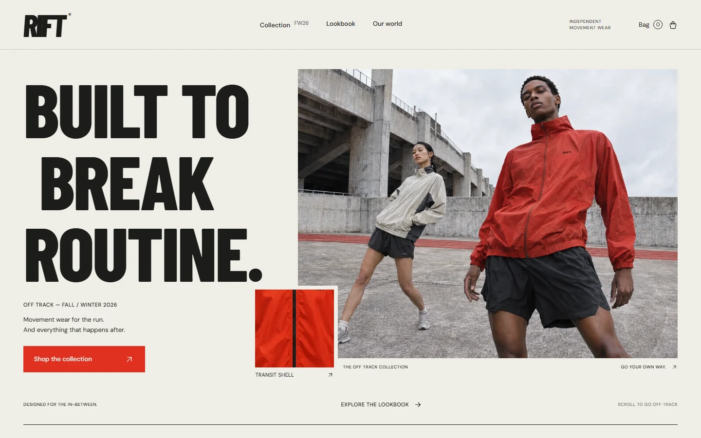
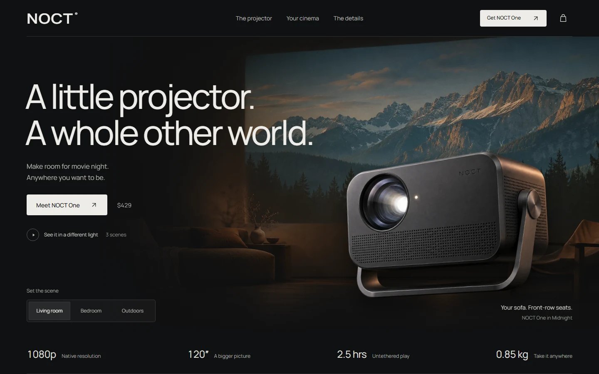
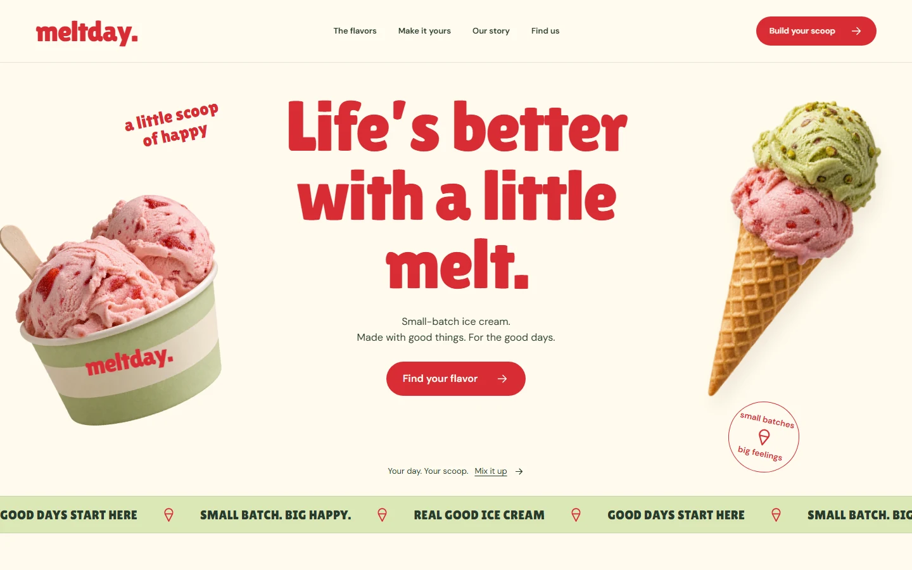
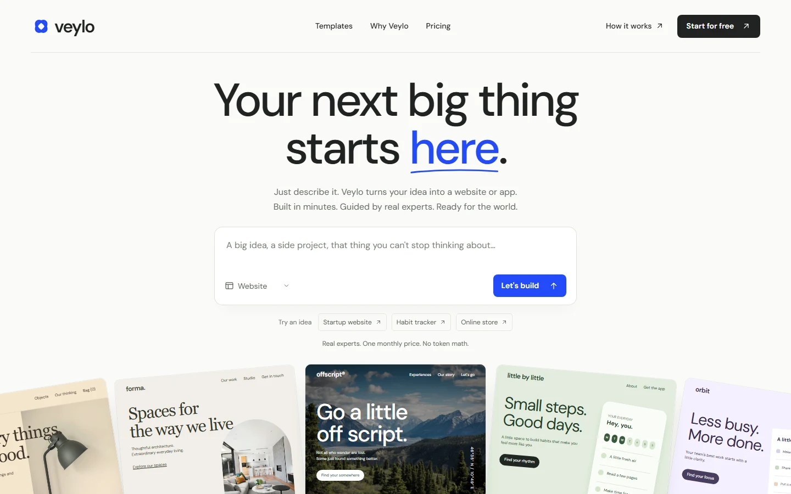

<p align="center">
  <picture>
    <source media="(prefers-color-scheme: dark)" srcset="docs/assets/logo-dark.svg">
    
  </picture>
</p>

<p align="center">
  <a href="README.md">简体中文</a> · <strong>English</strong>
</p>

<p align="center">
  <a href="https://github.com/Light0305/Light-UI-UX/releases"></a>
  <a href="LICENSE"></a>
  <a href="https://github.com/Light0305/Light-UI-UX/stargazers"></a>
</p>

**Good taste. For your AI.**

Light-UI-UX is a UI/UX design skill for AI coding agents. Turn an idea into a working interface, or refine the layout, interactions, and details of an existing project. It works on websites, web apps, mobile apps, and individual components with agents including Codex, Claude Code, Cursor, and Windsurf.

## Install

### Ask your agent

Send this to your coding agent:

```text
Install the Light-UI-UX skill from https://github.com/Light0305/Light-UI-UX.
First let me choose a global install or a specific project directory, then install it for the agent I use.
```

### Windows

Run in PowerShell or Command Prompt:

```powershell
npx.cmd skills@latest add Light0305/Light-UI-UX --skill light-ui-ux
```

### macOS / Linux

Run in your terminal:

```bash
npx skills@latest add Light0305/Light-UI-UX --skill light-ui-ux
```

The commands use the [skills CLI](https://github.com/vercel-labs/skills) and require **Node.js 22.20+ and Git**. The installer asks which agents to use and where to install: **Global** makes the skill available across projects; **Project** installs it in the current directory. Enter your project directory first for a project install.

The skill's scripts require **Python 3.10+**, with no third-party Python packages. Screenshots use a locally installed Chrome, Edge, or Chromium. You can also download the complete skill from [Releases](https://github.com/Light0305/Light-UI-UX/releases/latest) and place it in your agent's skills directory.

Then describe what you want to build:

```text
Use light-ui-ux to design and build a website for an independent record store.
Include record previews, weekly arrivals, and store details. Choose the visual direction and make it work on mobile.
```

## Showcase

Four projects, each built from one prompt in one conversation round. Click an image to read its original prompt.

<table>
  <tr>
    <td width="50%">
      <a href="docs/prompts/rift.md"></a>
      <strong>RIFT</strong> · Independent movement wear
    </td>
    <td width="50%">
      <a href="docs/prompts/noct.md"></a>
      <strong>NOCT</strong> · Portable cinema
    </td>
  </tr>
  <tr>
    <td width="50%">
      <a href="docs/prompts/meltday.md"></a>
      <strong>Meltday</strong> · Small-batch ice cream
    </td>
    <td width="50%">
      <a href="docs/prompts/veylo.md"></a>
      <strong>Veylo</strong> · AI website &amp; app builder
    </td>
  </tr>
</table>

## How it works

- **Start with the product.** Understand what visitors need to do, then decide whether the interface should lead with work, information, or actions. Marketing pages, workspaces, and reading experiences take different layouts.
- **Explore distinct directions before building.** New projects draw on real references to separate composition, typography, color, and imagery. Existing projects start with what is worth keeping and where the experience needs work.
- **Carry the details into working UI.** Guidance covers Chinese and Latin typography, hierarchy, spacing, color, responsive layouts, and interaction states for buttons, forms, and dialogs. Motion follows the content and the task.
- **Use media when it helps.** Search local components, icons, motion recipes, and design references, or call an image-generation tool. Images, animation, and effects are chosen for the design at hand.
- **Refine against the rendered result.** Check desktop and mobile layouts and use the main flows. Full pages and major redesigns also go through an independent visual review.

Supported stacks include HTML/CSS/JavaScript, React / Next.js, Vue / Nuxt, shadcn/ui, React Native / Expo, SwiftUI, and Flutter.

### Local design resources

Resources ship with the skill and are searched locally through SQLite full-text search.

| Resource | Count |
| --- | ---: |
| Website and award-site design references | 1,544 |
| Interactive component entries | 1,140 |
| Motion prompts and recipes | 660 |
| SVG icons | 33,253 |
| Brand design systems | 152 |
| Stack guidelines | 22 stacks |

Component entries include extractable source and upstream links. Each resource retains its original license. See [SKILL.md](SKILL.md) for the workflow and [references](references) for detailed guidance.

### Custom image models

The agent's native image-generation tool takes priority. When no host tool is available, it can use your configured API; without an API, it can search openly licensed media. You can also request a specific channel in your brief.

Copy [`.light-ui-ux.example.json`](.light-ui-ux.example.json) to `.light-ui-ux.json` in the skill's root directory, then enter your provider's endpoint, key, and model ID:

```json
{
  "api_url": "https://your-api.example/v1/images/generations",
  "api_key": "",
  "model": "YOUR_IMAGE_MODEL_ID",
  "provider": "openai-compatible"
}
```

The script supports **OpenAI Images-compatible endpoints**. Configuring an API does not override native image generation. Keep your actual endpoint and key local; `.light-ui-ux.json` and `.env` are excluded from Git and release archives. See [image configuration](docs/image-api.en.md).

### Included tools

| Tool | Purpose |
| --- | --- |
| [`arsenal.py`](scripts/arsenal.py) | Search references, components, icons, motion recipes, and stack guidance |
| [`style_explorer.py`](scripts/style_explorer.py) | Generate a style comparison page with desktop and mobile views |
| [`media_gen.py`](scripts/media_gen.py) | Configure image channels, retrieve media, and analyze images |
| [`inspect_ui.py`](scripts/inspect_ui.py) | Inspect pages, capture multiple viewports, and create text-masked screenshots |

## Feedback & support

- Email: [1833058953@qq.com](mailto:1833058953@qq.com)
- GitHub: [@Light0305](https://github.com/Light0305)
- [Issues](https://github.com/Light0305/Light-UI-UX/issues), pull requests, and usage feedback are welcome.

| Support via WeChat | WeChat official account |
| :---: | :---: |
|  |  |

## License

Original Light-UI-UX code and documentation use the [MIT License](LICENSE). Bundled third-party resources retain their own licenses; see [THIRD_PARTY_NOTICES.md](THIRD_PARTY_NOTICES.md) and [licenses](licenses).
