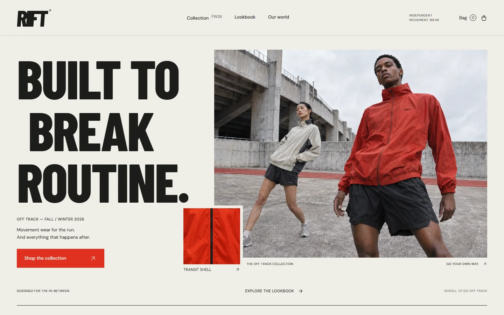
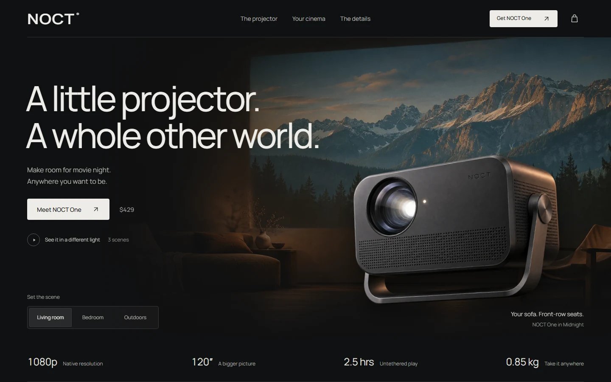
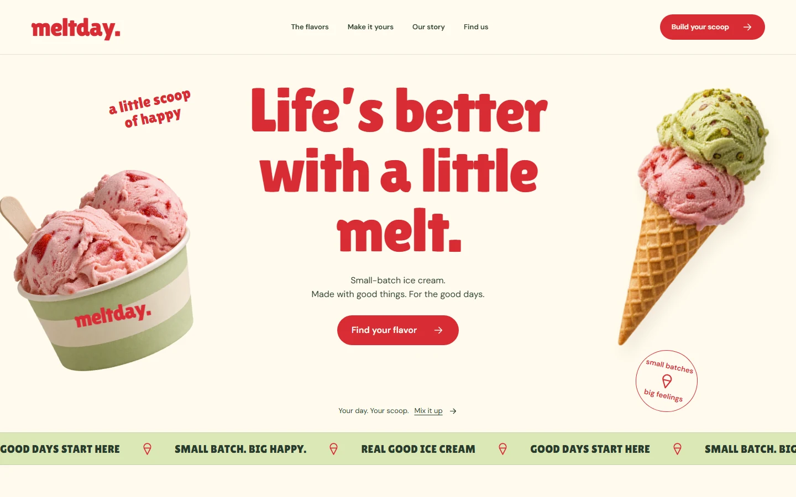
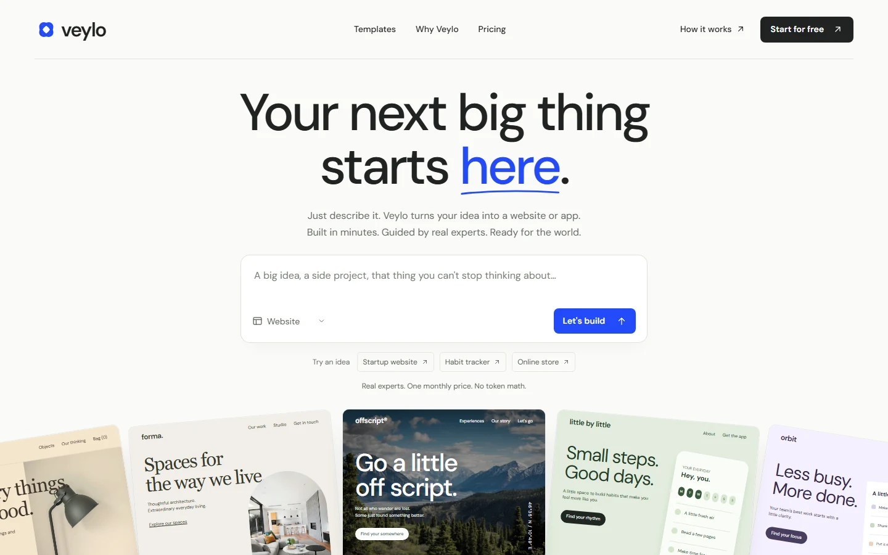

<p align="center">
  <picture>
    <source media="(prefers-color-scheme: dark)" srcset="docs/assets/logo-dark.svg">
    
  </picture>
</p>

<p align="center">
  <strong>简体中文</strong> · <a href="README.md">English</a>
</p>

<p align="center">
  <a href="https://github.com/Light0305/Light-UI-UX/releases"></a>
  <a href="LICENSE"></a>
  <a href="https://github.com/Light0305/Light-UI-UX/stargazers"></a>
</p>

**让 AI，也懂好设计。**

Light-UI-UX 是给 AI 编程工具用的 UI/UX 设计 Skill。从一句想法到可运行的界面，也能继续打磨已有项目的排版、交互和细节。适用于网站、Web 应用、移动应用和组件，支持 Codex、Claude Code、Cursor、Windsurf 等 Agent。

## 安装

### 交给 Agent

把下面这段话发给你的 Agent：

```text
帮我安装 Light-UI-UX 这个 skill，项目地址：https://github.com/Light0305/Light-UI-UX
安装前请让我选择全局安装，或安装到指定项目目录，再按我使用的 Agent 完成安装。
```

### Windows

在 PowerShell 或命令提示符中运行：

```powershell
npx.cmd skills@latest add Light0305/Light-UI-UX --skill light-ui-ux
```

### macOS / Linux

在终端运行：

```bash
npx skills@latest add Light0305/Light-UI-UX --skill light-ui-ux
```

命令安装使用 [skills CLI](https://github.com/vercel-labs/skills)，需要 **Node.js 22.20+ 和 Git**。安装时选择 Agent 和范围：**Global** 对所有项目生效，**Project** 仅对当前项目生效；项目安装请先进入对应目录。

Skill 脚本需要 **Python 3.10+**，无需安装第三方 Python 包。截图检查使用本机 Chrome、Edge 或 Chromium。也可以从 [Releases](https://github.com/Light0305/Light-UI-UX/releases/latest) 下载完整 Skill，放进 Agent 的 Skills 目录。

安装后直接描述任务：

```text
用 light-ui-ux 为一家独立唱片店设计并实现官网。
可以试听唱片、浏览每周新到和查看门店信息，风格由你来定，同时适配手机。
```

## 作品展示

四个作品，均由一条提示词、一轮对话完成。点击图片查看原始提示词。

<table>
  <tr>
    <td width="50%">
      <a href="docs/prompts/rift.md"></a>
      <strong>RIFT</strong> · 独立运动服饰
    </td>
    <td width="50%">
      <a href="docs/prompts/noct.md"></a>
      <strong>NOCT</strong> · 便携投影仪
    </td>
  </tr>
  <tr>
    <td width="50%">
      <a href="docs/prompts/meltday.md"></a>
      <strong>Meltday</strong> · 手作冰淇淋
    </td>
    <td width="50%">
      <a href="docs/prompts/veylo.md"></a>
      <strong>Veylo</strong> · AI 建站与应用生成
    </td>
  </tr>
</table>

## 它怎么做

- **从产品出发定设计。** 先弄清用户要完成什么，再决定界面该突出作品、信息还是操作。宣传页、后台和阅读页面各有适合的布局。
- **先拉开方向，再深入实现。** 新项目会结合真实参考，区分构图、字体、配色和主视觉；已有项目先判断哪些值得保留，再处理影响体验的问题。
- **把细节做到实际界面里。** 覆盖中英文排版、视觉层级、间距、配色、响应式布局，以及按钮、表单、弹窗等组件的交互状态。动效跟随操作和内容安排。
- **素材按需使用。** 可以检索本地组件、图标、动效与设计参考，也能调用生图工具。是否需要图片、动画或特效，由当前设计决定。
- **看着真实画面打磨。** 在桌面和手机尺寸下检查页面、操作主要流程；完整页面和较大改版还会进入独立视觉评审。

支持原生 HTML/CSS/JavaScript、React / Next.js、Vue / Nuxt、shadcn/ui、React Native / Expo、SwiftUI 和 Flutter 等技术栈。

### 本地设计资源

资源随 Skill 一起安装，通过 SQLite 全文检索，查找时无需联网。

| 资源 | 数量 |
| --- | ---: |
| 网站与获奖作品设计参考 | 1,544 |
| 交互组件索引 | 1,140 |
| 动效提示词与配方 | 660 |
| SVG 图标 | 33,253 |
| 品牌设计系统 | 152 |
| 技术栈指南 | 22 个技术栈 |

组件索引包含可提取源码和原站链接，各项资源保留其原有许可。设计方法见 [SKILL.md](SKILL.md)，分项说明见 [references](references)。

### 自定义生图模型

默认优先使用 Agent 自带的生图工具。没有可用的宿主生图工具时，再使用你配置的 API；未配置 API 时，可以检索开放授权素材。也可以在任务中指定生图通道。

将 Skill 根目录的 [`.light-ui-ux.example.json`](.light-ui-ux.example.json) 复制为 `.light-ui-ux.json`，填写服务商提供的接口地址、Key 和模型名：

```json
{
  "api_url": "https://your-api.example/v1/images/generations",
  "api_key": "",
  "model": "YOUR_IMAGE_MODEL_ID",
  "provider": "openai-compatible"
}
```

支持 **OpenAI Images 兼容接口**，填写配置不会覆盖宿主生图的优先级。真实 URL 和 Key 只保存在本地；`.light-ui-ux.json` 与 `.env` 已排除在 Git 和 Release 包之外。详见 [生图配置](docs/image-api.zh-CN.md)。

### 自带工具

| 工具 | 用途 |
| --- | --- |
| [`arsenal.py`](scripts/arsenal.py) | 检索设计参考、组件、图标、动效和技术栈指南 |
| [`style_explorer.py`](scripts/style_explorer.py) | 生成可切换桌面与手机尺寸的风格对比页 |
| [`media_gen.py`](scripts/media_gen.py) | 生图通道配置、素材检索与图片分析 |
| [`inspect_ui.py`](scripts/inspect_ui.py) | 页面检查、多视口截图与文字遮罩图 |

## 反馈与支持

- 邮箱：[1833058953@qq.com](mailto:1833058953@qq.com)
- GitHub：[@Light0305](https://github.com/Light0305)
- 欢迎 [Issue](https://github.com/Light0305/Light-UI-UX/issues)、PR 和使用反馈。

| 微信收款码 | 微信公众号 |
| :---: | :---: |
|  |  |

## 许可证

Light-UI-UX 的原创代码与文档采用 [MIT License](LICENSE)。内置第三方资源遵循各自许可，来源与许可文本见 [THIRD_PARTY_NOTICES.md](THIRD_PARTY_NOTICES.md) 和 [licenses](licenses)。
